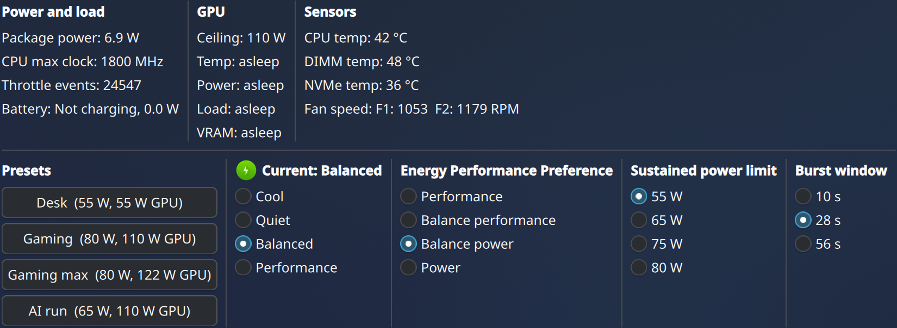

# Otter Power



A KDE Plasma 6 panel widget for the Dell Precision 7670 on Fedora. It switches the Dell platform profile, CPU energy preference, CPU sustained power limit and burst window, with one-click presets, and shows live temperatures, fan speeds and power draw.

## Quick start

```bash
git clone https://github.com/MicahOttah/otter-power.git
cd otter-power
bash install.sh
bash verify.sh
```

Then restart the panel and add the "Otter Power" widget:

```bash
plasmashell --replace >/dev/null 2>&1 & disown
```

## Disclaimer

**Please read this before you run anything. I'll wait.**

Your warranty is now void. Possibly. I haven't checked, and neither will Dell until you call them.

I am not responsible for any of the following:

- Bricked laptops, soft or hard
- Molten slag, or laptops that glow in the dark
- Fans that unionize and demand better working conditions
- Thermal paste achieving sentience
- A surprise visit from your local fire department
- Lost work, lost sleep, lost weekends, or a very long afternoon of reading `dmesg`
- Benchmarks that look worse than before you started
- **Global thermonuclear war**

Think of your laptop's firmware as a nervous parent with a strict curfew. This project quietly hands your CPU the car keys. The curfew exists for a reason, the neighbors (your heatsink) are already giving you looks, and the numbers in this project are limits, not suggestions.

You chose to run this on your own hardware, and nobody forced you. If something goes wrong, please do not blame me or the otter. I will be sympathetic and I may even send a "that's rough, buddy", but I will not be liable.

If you have any doubts, read the scripts before you run them. They are short, and everything this project does comes down to writing numbers into files under `/sys`. If a script does something you don't understand, that is a good reason not to run it.

The serious version, because the jokes are not a safety manual:

- This changes power and thermal behavior that the firmware normally owns. Higher limits mean more heat and more fan noise.
- Tested on one Dell Precision 7670 only. Modifiable, but your mileage may vary.
- Other Dell models, other BIOS versions and other kernels may behave differently, or may not expose the same files at all.
- Provided as is, with no warranty of any kind. See `LICENSE` for the formal terms.
- Nothing here has been tested on a clean install yet. The first clean run is the real test.
- Watch your temperatures after changing limits. If anything looks wrong, use the revert steps below, or just reboot with the pack uninstalled.
- If your laptop is physically hot enough to be alarming, shut it down and unplug it. Do that first, and file the bug report afterwards.

## Tested on

- Dell Precision 7670, Intel 12th gen Core i9 (HX), NVIDIA RTX A4500 Laptop GPU (16 GB)
- Fedora 44, KDE Plasma 6 on Wayland, kernel 7.2.x
- NVIDIA open kernel modules from RPM Fusion (not required for the applet itself)

## What it does

**Controls**

- Dell platform profile: cool, quiet, balanced, performance (`/sys/firmware/acpi/platform_profile`)
- CPU Energy Performance Preference, set on every core
- CPU sustained power limit: 55, 65, 75 or 80 W (`intel-rapl-mmio:0`, constraint 0)
- CPU burst window: 10, 28 or 56 s
- Presets that set all of the above together

**Monitoring**

- Package power, CPU max clock, throttle count, battery state
- GPU ceiling, temperature, power, load and VRAM (only queried while the GPU is awake, so it never wakes a sleeping card)
- CPU, DIMM and NVMe temperatures, fan speeds

**Persistence**

Your last choices are saved in `~/.config/powerctl/` and reapplied at login and after suspend and resume.

## Presets

| Preset | Profile | EPP | CPU sustained limit | Burst window |
|---|---|---|---|---|
| Desk | cool | balance_power | 55 W | 28 s |
| Gaming | balanced | balance_performance | 80 W | 28 s |
| Gaming max | performance | balance_performance | 80 W | 28 s |
| AI run | balanced | balance_power | 65 W | 56 s |

Edit the `presets` list near the top of `main.qml` to change these.

## What the installer does

It installs `plasma-sdk`, `kf6-kpackage` and `lm_sensors`, adds you to the `wheel` group if needed (log out and back in afterwards), copies the files below, installs the applet, enables the services and reloads the udev rules. It is safe to run more than once.

User files:

- `~/plasmoids/io.github.micahottah.otterpower/` (the applet source, installed with `kpackagetool6`)
- `~/.local/bin/powerctl-read.sh` and `powerctl-restore.sh`
- `~/.config/systemd/user/powerctl-restore.service` (applies your saved choices at login)

System files:

- `/etc/tmpfiles.d/cpu-epp.conf` and `platform-profile.conf` (write access to EPP and the platform profile for the `wheel` group)
- `/etc/udev/rules.d/91-platform-profile.rules` and `92-rapl-perms.rules` (permissions on the power limit, burst window and energy counter, applied whenever the kernel creates those files)
- `/usr/local/bin/set-rapl-limit.sh` (runs as root, so it lives outside your home directory)
- `/etc/systemd/system/rapl-limit.service` (sets default limits at boot, before login)
- `/etc/systemd/system/powerctl-resume.service` (reapplies limits after resume, generated at install time with your username)

The helper scripts, services and settings folder keep the older `powerctl` name. The applet itself is Otter Power.

## What I measured on my unit

These are observations from one machine, not guarantees.

- The platform profile does more than cooling. The GPU power ceiling followed it: about 55 W in Cool and Quiet, 110 W in Balanced and about 122 W in Performance. In one game, frame rate scaled with the ceiling (roughly 25, 50 and 55 FPS).
- The profiles also differ in fan policy. In Cool the fans keep spinning at idle. In Performance both fans stopped at idle and started late under a sudden load (the CPU reached 96 C before they responded).
- The CPU sustained limit that mattered was the `intel-rapl-mmio:0` zone, 55 W by default and the same in every profile. The `intel-rapl:0` zone sat at 85 W and was not the binding one.
- A shorter burst window cut the time spent at 100 C at the start of a heavy load. At 85 W the CPU hovered around 76 W, so 80 W is the top option in the applet. I did not find out why.
- The GPU power limit cannot be changed from the driver on this machine (`nvidia-smi -pl` is refused). The GPU ceiling shown in the applet is a lookup of the values measured above, not a live reading, and one reading of about 116 W did not match any profile.
- Fan control through `dell-smm-hwmon` did not work: writes were accepted but ignored, and the firmware keeps its own fan curve. The applet does not offer fan control.

## Not covered

Hardware and driver setup is separate and depends on your release: the NVIDIA driver, GPU runtime power management, `thermald`, tuned profiles, kernel arguments and BIOS settings.

## Revert and uninstall

To go back to the firmware defaults without uninstalling, set the values by hand. The services reapply your saved choices at the next login, so uninstall if you want the change to stick:

```bash
echo 55000000 | sudo tee /sys/class/powercap/intel-rapl-mmio:0/constraint_0_power_limit_uw
echo 56000000 | sudo tee /sys/class/powercap/intel-rapl-mmio:0/constraint_0_time_window_us
echo cool > /sys/firmware/acpi/platform_profile
```

To uninstall completely:

```bash
systemctl --user disable --now powerctl-restore.service
sudo systemctl disable --now rapl-limit.service powerctl-resume.service
sudo rm -v /etc/systemd/system/rapl-limit.service /etc/systemd/system/powerctl-resume.service /usr/local/bin/set-rapl-limit.sh
sudo rm -v /etc/udev/rules.d/91-platform-profile.rules /etc/udev/rules.d/92-rapl-perms.rules
sudo rm -v /etc/tmpfiles.d/cpu-epp.conf /etc/tmpfiles.d/platform-profile.conf
sudo systemctl daemon-reload
sudo udevadm control --reload
rm -v ~/.local/bin/powerctl-read.sh ~/.local/bin/powerctl-restore.sh ~/.config/systemd/user/powerctl-restore.service
rm -rf ~/.config/powerctl
kpackagetool6 -t Plasma/Applet -r io.github.micahottah.otterpower
rm -rf ~/plasmoids/io.github.micahottah.otterpower
```

Reboot afterwards so the firmware defaults return.

## License

GPL-2.0-or-later. See `LICENSE`.
